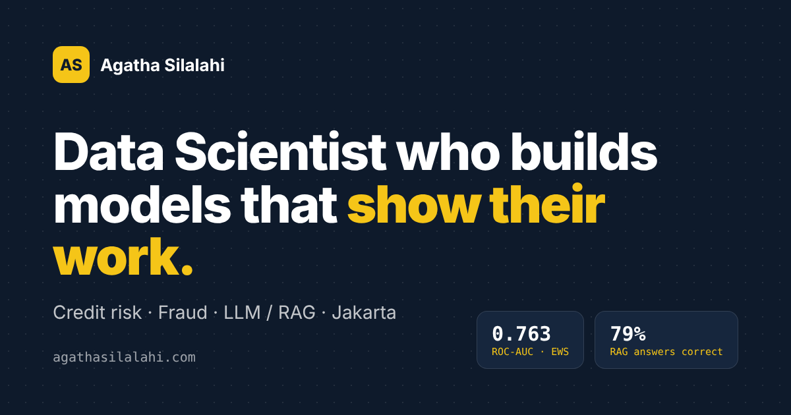

# Agatha Silalahi · Portfolio

Personal portfolio of **Agatha Ulina Silalahi**, data scientist in Jakarta (credit risk, fraud, NLP and LLM applications).

**Live site:** https://agathahah.github.io · Bahasa Indonesia: https://agathahah.github.io/?lang=id



## What's on the site

- **About:** from teaching mathematics to data science at Bank Indonesia Institute.
- **Education:** Universitas Indonesia (M.Si. Mathematics, Data Science), Universitas Negeri Medan, Pacmann Academy, DQLab.
- **Experience:** Bank Indonesia Institute (NLP research) and Bank Rakyat Indonesia (LLM resume parser).
- **Projects**, each with its repository and the evaluation behind every number:

| Project | Area | Links |
|---|---|---|
| FinSight IDX: RAG question answering over a 747-page annual report | LLM · RAG | [Live demo](https://huggingface.co/spaces/Agatha1911/finsight-idx) · [Repo](https://github.com/Agathahah/finsight-idx) |
| Credit Default EWS: early warning model with explainability | Credit risk | [Repo](https://github.com/Agathahah/credit-default-ews) |
| CreditLens: credit scoring research with a release gate | Credit risk | [Dashboard](https://creditlens-risk-evidence.streamlit.app/) · [Repo](https://github.com/Agathahah/creditlens) |
| Credit risk data pipeline: ETL to model on PostgreSQL and SQLite | Data engineering | [Repo](https://github.com/Agathahah/credit-data-pipeline) |
| NusaCommerce: e-commerce analytics with RFM segmentation | Analytics | [Tableau](https://public.tableau.com/app/profile/agatha.silalahi/viz/NusaCommerceExecutiveDashboard/Dashboard1) · [Looker Studio](https://lookerstudio.google.com/reporting/617f29b4-3925-4943-8729-68fd4bfff227) · [Repo](https://github.com/Agathahah/shopee-indonesia-analytics) |
| SIGAP: account-opening fraud scoring with an analyst copilot (in progress, Nov 2026) | Fraud · MLOps · AI agent | [BAF paper](https://arxiv.org/abs/2211.13358) |

- **Skills** and **contact** (email, LinkedIn, GitHub, Hugging Face, Tableau) and a downloadable CV.

## Built with

Plain HTML, CSS and JavaScript in a single `index.html`, with no build step and no analytics.
English and Indonesian text, a project filter, a screenshot viewer, light and dark mode, and a layout that works on phones.
Hosted on GitHub Pages.

```
index.html              the whole site
assets/photo.jpg        portrait
assets/logos/           institution logos
assets/shots/           project screenshots and charts
assets/og-image.png     link preview image
assets/Agatha-Silalahi-CV.pdf
```

Run it locally:

```bash
git clone https://github.com/Agathahah/agathahah.github.io.git
cd agathahah.github.io
python3 -m http.server 8000   # then open http://localhost:8000
```

## Credits

Institution logos belong to their owners and are used only to identify where I studied or worked.
The Bank Indonesia and BRI logos come from Wikimedia Commons.
Fonts: Bricolage Grotesque, Plus Jakarta Sans and JetBrains Mono (Google Fonts).

© 2026 Agatha Ulina Silalahi. Text, photos and project descriptions may not be reused without permission.
